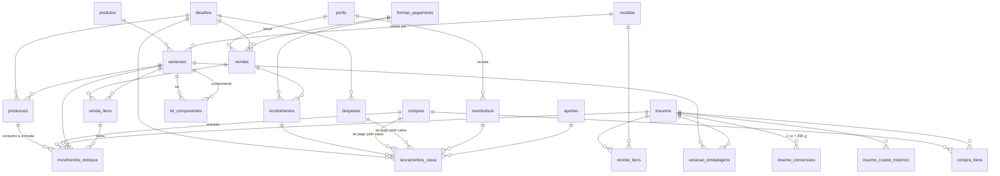

# Plano — Checkpoint 2

> Etapa 3 da `docs/especificacao.md`. Baseado no `docs/diagnostico.md` e nas suas respostas de 27/10/2026.
> **Aprovado em 27/10/2026**, com a decisão D2 aprovada e a D1 ainda em aberto.

## 0. Decisões que preciso que você confirme

Cada item já está aplicado no plano abaixo. Se discordar de algum, me diga o número.

| # | Decisão | Por quê |
|---|---|---|
| D1 | **Teste num segundo projeto Supabase** (reativar o pausado dos EUA, depois de conferir que está vazio). Tudo é testado lá antes de ir para o `appgestãogeladinho` | *Branches* do Supabase exigem plano pago. Um projeto separado evita misturar estoque de teste com estoque real |
| D2 | **Apagar a tabela vazia `bancogestão`** e a política que libera tudo para qualquer pessoa | Ela tem 0 linhas e é uma porta aberta. É uma operação destrutiva, por isso peço o seu "pode" |
| D3 | **Login com e-mail e senha.** Você cadastra os 4 ou 5 participantes pelo painel do Supabase (Authentication → Add user), e o sistema pede o nome no primeiro acesso | Com tão poucas pessoas, não vale colocar a chave `service_role` em lugar nenhum. Link mágico por e-mail é ruim com sinal fraco na rua |
| D4 | **Sem fila offline.** Aviso claro de "não salvo", reenvio com um toque e proteção contra duplicidade | Fila offline com estoque compartilhado gera conflitos difíceis. Pode virar uma fatia extra depois |
| D5 | **Kit fixo, montado na hora da venda** (ex.: casadinha = 1 clássico + 1 avelã). Vender o kit baixa os componentes | É o que a planilha mostra |
| D6 | **Cliente opcional**, obrigatório só em encomenda e em venda pendente ou parcial | Agiliza a venda na rua e garante saber de quem cobrar |
| D7 | **Encomenda:** o dinheiro entra no caixa quando é recebido. Estoque e resultado mudam **na entrega** | A especificação manda baixar o estoque na entrega. Reconhecer a margem junto evita resultado sem custo |
| D8 | **Venda sem produto pronto: avisar e pedir confirmação, sem bloquear.** Produção sem insumo: **bloquear** | Na rua, o produto pode estar na mão sem ter sido lançado. O aviso fica registrado. O teste 15 exige exatamente o aviso |
| D9 | **Custo atual do insumo = preço da última compra**, que o administrador pode corrigir à mão. Todo preço anterior fica no histórico | Simples de entender num desafio de 7 dias. A alternativa, custo médio, é mais difícil de conferir |
| D10 | **Embalagem é baixada na produção** (o produto fica pronto já embalado). Embalagem própria do kit é baixada na venda | Coerente com a planilha (embalagem no custo de cada produto) |
| D11 | **Membro corrige o próprio lançamento em até 30 minutos.** Corrigir = cancelar com motivo e lançar de novo, já preenchido. Depois disso, só o administrador | Mantém o histórico sem apagar nada (Seção 4.7) |
| D12 | **Cadastro e estoque são únicos**, valendo entre desafios. Vendas, despesas e produção pertencem a um desafio | O estoque físico que sobra continua existindo no desafio seguinte |
| D13 | **Publicação na Vercel**, acessível só para quem tem login | Pergunta 7, sem resposta. Usuário não logado não lê nada (teste 17) |
| D14 | **ROI fora do sistema** até você definir a fórmula | Pergunta sem resposta. A planilha não tem uma definição reproduzível |
| D15 | **Todos os participantes veem todos os números** do desafio. Só o que cada um **altera** é restrito | Equipe de 4 a 5 pessoas. Transparência ajuda a conferir |

---

## 1. Stack e arquitetura

| Parte | Escolha | Motivo |
|---|---|---|
| Aplicação | **Next.js (App Router) + TypeScript**, versão estável atual, fixada no início | Preferência da especificação. Publica direto na Vercel |
| Estilo | **Tailwind CSS** com tokens próprios (cores, espaçamentos, tamanhos) e componentes reutilizáveis | Seção 6.4 |
| Banco e login | **Supabase** (Postgres, Auth, RLS) via `@supabase/ssr` | O login fica em *cookie* e funciona nas páginas do servidor |
| Regras de negócio | **Funções do Postgres (RPC)** para toda operação composta. **Views** para os números do painel | Uma transação por operação. O navegador não calcula resultado definitivo (Seção 5) |
| Camada de serviço | `src/servicos/*.ts`: funções finas e tipadas que chamam as RPC e as views. Tipos gerados do banco | Um único lugar para chamar o banco. Nenhuma tela refaz cálculo |
| Validação | `zod` no formulário, só para avisar rápido. O banco valida de novo e decide | O formulário ajuda, o banco garante |
| Gráficos | Recharts (barras por dia, linha acumulada contra a meta) | Leve e suficiente para 7 dias |
| Exportação | Rota do servidor que lê o Supabase com a sessão do usuário (RLS vale) e gera **XLSX** (`exceljs`) ou **CSV** | Seção 4.8: os dados vêm do banco, não da tela |
| Instalação no celular | *Manifest* para "Adicionar à tela inicial" (abre como aplicativo). Sem *service worker* de dados (D4) | Rápido de abrir, sem complexidade offline |
| Testes | Scripts SQL de aceite rodados no projeto de **teste**. Playwright em viewport de 375 px para os fluxos | Seção 10 |

### 1.1 Como uma venda é gravada

```
Celular                      Servidor (Vercel)                 Supabase (Postgres)
───────                      ─────────────────                 ───────────────────
abre "Nova venda"
  └─ gera chave UUID
toca "Confirmar"  ───────▶   Server Action
  (botão travado)              └─ chama RPC registrar_venda ─▶ BEGIN
                                  com o login do usuário          confere papel e chave (já existe? devolve a mesma venda)
                                                                  trava saldos de estoque (FOR UPDATE)
                                                                  grava venda + itens + custo do momento
                                                                  grava movimentos de estoque
                                                                  grava recebimento + lançamento de caixa
                                                                  auditoria (gatilhos)
                                                                COMMIT
mostra "Venda nº 42 salva"  ◀─── resultado ◀──────────────────
  ou "Não salvo, tocar para reenviar" (mesma chave: nunca duplica)
```

- Nenhuma chave secreta vai para o navegador. O servidor usa só a chave pública e o login do participante.
- A `service_role` **não é usada** (D3).

---

## 2. Modelo de dados

### 2.1 Convenções

- **Dinheiro:** `numeric(12,2)`.
- **Custo por unidade base** (ex.: R$ por grama): `numeric(14,6)`, arredondado só no valor final.
- **Quantidades:** `numeric(14,3)`.
- **Datas:** `timestamptz`. O "dia" é sempre calculado em `America/Fortaleza`.
- **Registro:** toda tabela importante tem `criado_por`, `criado_em`, `alterado_por` e `alterado_em` (preenchidos por gatilho), além de RLS ligada.
- **Nada financeiro ou de estoque é apagado.** Há colunas de cancelamento (`cancelado_em`, `cancelado_por`, `motivo_cancelamento`) e lançamentos de estorno.
- **Livros-razão:** movimentos de estoque e lançamentos de caixa só aceitam inclusão. Correção é um novo lançamento de sinal contrário.
- **Idempotência:** coluna `chave_idempotencia uuid unique` em vendas, recebimentos, compras, despesas, reembolsos, aportes, ajustes e produções. Um reenvio com a mesma chave devolve o registro já gravado, sem duplicar.

### 2.2 Tabelas

**Acesso e configuração**

| Tabela | Colunas principais | Observações |
|---|---|---|
| `perfis` | `id` (= usuário do Auth), `nome`, `papel` (administrador / membro), `ativo` | Criado no primeiro login. Só o administrador muda papel |
| `desafios` | `nome`, `inicio`, `fim`, `meta_resultado`, `meta_vendas` (opcional), `situacao` (planejado / em andamento / encerrado) | A meta é cadastrável ("a gente define") |
| `demanda_estimada` | `desafio_id`, `variacao_id`, `unidades_por_dia` | Usada na cobertura de estoque antes de 2 dias de vendas, sempre rotulada "estimativa" |
| `formas_pagamento` | `nome`, `taxa_percentual`, `ativa`, `ordem` | Pix sem taxa já cadastrado. Todas caem no **mesmo caixa** (conta Pix única) |

**Cadastro (produtos, receitas, custeio)**

| Tabela | Colunas principais | Observações |
|---|---|---|
| `unidades` | `codigo` (g, kg, ml, l, und), `dimensao` (massa / volume / contagem), `fator_para_base` | Base: g, ml, und. Converte só dentro da mesma dimensão |
| `insumos` | `nome`, `tipo` (ingrediente / embalagem / outro), `unidade_base`, `custo_atual` (por unidade base), `fornecedor`, `validade`, `estoque_minimo`, `ativo` | |
| `insumo_conversoes` | `insumo_id`, `unidade` (cx, pacote, garrafa…), `quantidade_em_base` | Ex.: 1 cx de leite condensado = 395 g. **Obrigatória** para usar "cx" |
| `insumo_custos_historico` | `insumo_id`, `custo_por_base`, `vigente_desde`, `origem` (compra / manual), `compra_id` | D9. Teste 3 |
| `receitas` | `nome`, `rendimento_unidades`, `ativa` | Uma "fornada" = uma receita |
| `receita_itens` | `receita_id`, `insumo_id`, `quantidade`, `unidade`, `quantidade_base` | `quantidade_base` é calculada pelo banco. Unidade incompatível é recusada |
| `produtos` | `nome`, `categoria`, `tipo` (simples / kit), `ativo`, `apelidos[]`, `ordem` | Apelidos entram na busca ("combo", "combinado") |
| `variacoes` | `produto_id`, `nome` (ex.: "chocolate"), `receita_id`, `preco_venda`, `ativa` | **O que se vende e se estoca é a variação.** Produto sem sabor tem uma variação "única" |
| `variacao_embalagens` | `variacao_id`, `insumo_id`, `quantidade_por_unidade` | D10 |
| `kit_componentes` | `kit_variacao_id`, `componente_variacao_id`, `quantidade` | Casadinha → 1 clássico + 1 avelã |

**Estoque e produção**

| Tabela | Colunas principais | Observações |
|---|---|---|
| `movimentos_estoque` | `insumo_id` **ou** `variacao_id`, `tipo` (compra / consumo_producao / entrada_producao / venda / doacao / perda / ajuste / estorno), `quantidade_base` (+ entra, − sai), `custo_unitario`, `origem_tipo`, `origem_id`, `justificativa`, `desafio_id` | Livro único (Seção 4.4). Ajuste e perda exigem justificativa |
| `saldos_estoque` | item, `saldo` | **Mantido só por gatilho** a partir dos movimentos. Ninguém digita. Existe para permitir o bloqueio de linha (concorrência). Uma consulta de conferência compara com a soma do livro |
| `producoes` | `desafio_id`, `variacao_id`, `receita_id`, `fornadas`, `unidades_previstas`, `situacao` (planejada / concluída / cancelada), `unidades_produzidas`, `unidades_perdidas`, `concluida_em` | Planejada não mexe no estoque |

**Vendas**

| Tabela | Colunas principais | Observações |
|---|---|---|
| `vendas` | `desafio_id`, `numero` (curto, para conferir), `data_hora`, `tipo` (venda / encomenda / doação), `participante_id`, `cliente`, `observacao`, `forma_pagamento_id`, `taxa_percentual` (do momento), `subtotal`, `desconto`, `total`, `situacao_pagamento` (paga / parcial / pendente, calculada), `situacao_entrega` (aguardando produção / pronta / entregue), `entrega_prevista`, `entregue_em`, `estoque_negativo_confirmado`, campos de cancelamento | Doação tem total 0 e nunca tem recebimento |
| `venda_itens` | `venda_id`, `variacao_id`, `quantidade`, `preco_unitario`, `desconto_rateado`, `valor_liquido`, `custo_unitario_momento`, `taxa_rateada`, `margem_contribuicao` | **O custo e a margem ficam congelados na venda** (Seção 4.1). Mudança de preço nunca reescreve o passado |
| `recebimentos` | `venda_id`, `valor`, `forma_pagamento_id`, `taxa_valor`, `recebido_em`, `estorno_de` | Venda ≠ dinheiro. Uma venda pode ter vários recebimentos |

**Financeiro**

| Tabela | Colunas principais | Observações |
|---|---|---|
| `compras` / `compra_itens` | data, fornecedor, `pago_por` (caixa / participante), `participante_id`, total. Itens: insumo, quantidade, unidade, `quantidade_base`, valor | Aumenta o estoque. **Não entra no resultado** |
| `despesas` | data, descrição, categoria, valor, `pago_por`, `participante_id` | Entra no resultado **uma vez** |
| `reembolsos` | `participante_id`, valor, `pago_em` | Saída de caixa que quita a dívida. Não mexe no resultado |
| `aportes` | `origem` (participante / PJ), `participante_id`, valor | Entra no caixa. Não é receita |
| `lancamentos_caixa` | `tipo` (recebimento / taxa / compra / despesa / reembolso / aporte / ajuste / estorno), `valor` (+ entra, − sai), `origem_tipo`, `origem_id`, `justificativa`, `desafio_id` | **Livro de caixa**: só dinheiro que de fato entrou ou saiu. Compra ou despesa paga do bolso do participante **não** gera lançamento de caixa; gera dívida de reembolso |
| `auditoria` | `tabela`, `registro_id`, `acao`, `antes` (jsonb), `depois` (jsonb), `usuario_id`, `em` | Gatilho em vendas, itens, recebimentos, despesas, compras, insumos (preço), variações (preço), receitas, movimentos de estoque, produções e desafios (metas) |

### 2.3 Diagrama



### 2.4 Funções RPC (cada uma é uma transação)

| Função | Quem pode | O que faz |
|---|---|---|
| `registrar_venda(chave, tipo, itens[], forma, valor_recebido, desconto, cliente, obs, entrega_prevista, confirmar_estoque_negativo)` | membro, admin | Calcula preços, rateia o desconto e congela custo, taxa e margem por item. Venda imediata ou doação: trava saldos, baixa estoque (kit → componentes) e devolve aviso se faltar produto (D8). Encomenda: não baixa. Grava recebimento e caixa se houve pagamento |
| `registrar_recebimento(chave, venda_id, valor, forma)` | membro, admin | Recebimento + lançamento de caixa (com taxa). Atualiza a situação de pagamento |
| `entregar_encomenda(chave, venda_id, confirmar_estoque_negativo)` | membro, admin | Baixa o estoque e reconhece a margem na data da entrega (D7) |
| `cancelar_venda(venda_id, motivo)` | admin; membro na própria, em até 30 min | Marca como cancelada, devolve o estoque (se já tinha baixado), estorna os recebimentos no caixa. Nada é apagado |
| `registrar_compra(chave, itens[], pago_por, participante, fornecedor)` | membro, admin | Entrada no estoque, novo custo atual + histórico (D9), saída de caixa **ou** dívida de reembolso |
| `registrar_despesa(chave, valor, descricao, categoria, pago_por, participante)` | membro, admin | Despesa + saída de caixa **ou** dívida de reembolso |
| `pagar_reembolso(chave, participante, valor)` | admin | Saída de caixa. Não pode passar do saldo devido |
| `registrar_aporte(chave, origem, participante, valor)` | admin | Entrada de caixa |
| `planejar_producao(chave, variacao, fornadas)` | membro, admin | Só planeja |
| `concluir_producao(chave, producao_id, unidades_produzidas, perdas)` | membro, admin | Trava saldos, confere insumos e embalagens. **Se faltar, não grava e devolve a lista do que falta e quanto.** Se houver, grava consumo, entrada do produto pronto (com custo) e perdas |
| `ajustar_estoque(chave, item, quantidade, justificativa)` / `registrar_perda(...)` | admin; membro com justificativa | Movimento de ajuste ou perda |
| `ajustar_caixa(chave, valor, justificativa)` | admin | Lançamento de ajuste |

Todas usam `SECURITY DEFINER`, `search_path` fixo e checagem de papel logo no começo. As tabelas financeiras e de estoque **não** aceitam `INSERT`, `UPDATE` ou `DELETE` direto do navegador: só por essas funções.

### 2.5 Views de leitura

- `v_custo_variacao`: custo da receita, custo variável unitário, MC, MC % e markup (Seção 4.1). Usada nos testes de aceite 1 e 2.
- `v_saldo_estoque`, `v_producao_possivel` (fornadas possíveis e insumo que limita), `v_lista_compras`, `v_cobertura_estoque`.
- `v_fluxo_caixa`, `v_saldo_caixa`, `v_a_receber`, `v_reembolsos_devidos`.
- `v_resultado_diario` e `v_painel_meta`: realizado, meta, %, quanto falta, dias, ritmo necessário, projeção de unidades com as premissas.

### 2.6 Políticas RLS (resumo)

- **Usuário não logado:** nada, em nenhuma tabela (permissões do papel `anon` revogadas).
- **Logado e ativo:** lê tudo do desafio (D15).
- **Cadastro e preços** (insumos, receitas, produtos, variações, formas de pagamento, desafios, metas): só o **administrador** altera (teste 17).
- **Financeiro e estoque:** ninguém altera direto. Só pelas funções da Seção 2.4, que conferem quem pode o quê. `DELETE` revogado para todos.
- **Auditoria:** só leitura, só para o administrador.
- Depois de cada migration: *advisors* de segurança e de desempenho, com os alertas corrigidos.

### 2.7 Regras de cálculo

Vão para `docs/regras-de-negocio.md` na fatia 1.

- **Custo da receita** = Σ (quantidade base do insumo × custo atual por unidade base).
- **Custo variável unitário** = custo da receita ÷ rendimento + Σ embalagens por unidade. Para um kit: Σ (custo do componente × quantidade) + embalagens do kit.
- **MC do item vendido** = valor líquido (preço × quantidade − desconto rateado) − custo do momento × quantidade − taxa rateada.
- **MC %** = MC ÷ valor líquido. **Markup** = preço ÷ custo.
- **Resultado** = Σ MC das vendas reconhecidas − custo das doações e perdas − despesas. Vendas canceladas ficam de fora; encomenda só conta a partir da entrega.
- **Saldo de caixa** = Σ lançamentos de caixa.
- **Saldo de reembolso do participante** = Σ (compras e despesas pagas por ele, não canceladas) − Σ reembolsos pagos a ele.
- **Ritmo necessário por dia** = (meta − realizado) ÷ dias restantes, **contando hoje**.
- **Projeção de unidades para a meta** = (meta − realizado) ÷ MC média por unidade, pelo mix vendido até agora. A tela mostra as premissas e o rótulo "projeção".

---

## 3. Mapa de telas

### 3.1 Navegação

- **Barra inferior** (5 posições, ao alcance do polegar): **Início**, **Vendas**, **＋ Nova venda** (botão central de destaque), **Estoque**, **Caixa**.
- **Menu "Mais"** (canto superior): Produtos e receitas, Insumos, Desafio e meta, Formas de pagamento, Participantes, Exportar, Auditoria e "Como calculamos". A maior parte é só do administrador.
- **Faixa fixa** no topo quando a conexão cai: "Sem conexão — o que você lançar agora não será salvo".

### 3.2 Telas

| Tela | Conteúdo, em ordem de importância |
|---|---|
| **Início** | 1. Resultado do desafio e barra da meta (realizado, falta, ritmo por dia). 2. Saldo de caixa. 3. A receber. 4. Pendências: encomendas a entregar, reembolsos devidos, estoque abaixo do mínimo. 5. Gráfico: barras de resultado por dia e linha acumulada contra a meta. **Cada número leva aos registros que o formam** |
| **Vendas** | Chips: Hoje / Todas / A receber / Encomendas / Doações / Canceladas, com contagem. Lista em cartões (nº, hora, itens, valor, situação). Filtros por dia, produto, participante e forma de pagamento. Detalhe da venda: receber, entregar, cancelar |
| **Nova venda** | Grade de produtos ativos (mais vendidos primeiro, com preço). Quantidade com + e −. Total sempre visível. Forma de pagamento (a última usada já marcada). Paga / Pendente / Parcial. "Mais opções" recolhido: desconto, cliente, observação, encomenda, doação. Botão "Confirmar R$ 20,00" |
| **Estoque** | Abas: **Produtos prontos** / **Insumos** / **Produção**. Saldo com unidade, cobertura em dias ("estimativa" quando for o caso), quanto dá para produzir e o insumo que limita, lista de compras |
| **Produção** | Planejadas e concluídas. "Planejar" e "Concluir". Na falta de insumo, a lista do que falta com os botões "Registrar compra" e "Ajustar estoque" |
| **Caixa** | Saldo de caixa e resultado lado a lado, **separados**. Botões: Despesa, Compra, Reembolso, Aporte. Livro de caixa por dia. "A reembolsar" por participante |
| **Produtos e receitas** (admin) | Produto → variações → receita (insumos e rendimento) → embalagens → preço. Mostra o custo, a MC e o markup calculados na hora, como **prévia**; o número oficial é sempre o do banco |
| **Insumos** (admin) | Nome, tipo, unidade base, conversões (cx → g), custo atual, histórico de preço |
| **Desafio e meta** (admin) | Datas, meta de resultado, meta de vendas, demanda estimada, situação |
| **Exportar** | Tipo, período, produto, participante → XLSX ou CSV |
| **Estados em todas as telas** | Carregando (bloco cinza estático, **nunca "R$ 0,00" falso**), vazio (frase + ação, ex.: "Nenhuma venda hoje. Toque em ＋ para lançar"), erro (o que houve + como resolver + "tentar de novo"), sucesso (confirmação curta com "desfazer" quando couber) |

### 3.3 Fluxos principais, em toques

Contando a partir de qualquer tela, com os padrões preenchidos (hoje, último pagamento usado, participante logado). Digitar um texto ou valor conta como 1 passo.

| Ação | Passos | Toques |
|---|---|---|
| **Venda de 1 item, paga no Pix** | ＋ → produto → Confirmar | **3** |
| Venda de 3 itens iguais | ＋ → produto → + → + → Confirmar | 5 |
| Venda de 2 produtos ("1 piscina e 1 combinado") | ＋ → produto A → produto B → Confirmar | 4 |
| Venda pendente (fiado) | ＋ → produto → Pendente → cliente (digitar) → Confirmar | 5 |
| Encomenda | ＋ → produto(s) → Mais opções → Encomenda → data de entrega → cliente → Paga ou Pendente → Confirmar | 8–9 |
| Doação | ＋ → Mais opções → Doação → produto → quantidade → Confirmar | 6 |
| Receber venda pendente | Vendas → A receber → venda → Receber (valor do saldo já preenchido) → Confirmar | 5 |
| Entregar encomenda | Vendas → Encomendas → venda → Marcar entregue → Confirmar | 5 |
| Despesa paga do próprio bolso | Caixa → Despesa → valor → descrição (ou chip de categoria) → "Paguei do meu bolso" → Confirmar | 6 |
| Compra de insumos (2 itens) | Caixa → Compra → insumo → quantidade e unidade → valor → insumo → quantidade → valor → pago por → Confirmar | 10 |
| Concluir produção | Estoque → Produção → produção planejada → (unidades já preenchidas com o previsto) → Concluir | 4 |
| Cancelar venda | venda → Cancelar → motivo (chip) → Confirmar | 4 |
| Pagar reembolso | Caixa → A reembolsar → participante → Pagar (valor devido já preenchido) → Confirmar | 5 |

---

## 4. Ordem de construção

Cada fatia termina **funcionando de ponta a ponta**, com dados gravados no projeto de teste e testada. Só então as migrations vão para o projeto principal. No fim de cada fatia, você recebe um resumo de 3 a 5 linhas e como testar no celular.

| Fatia | Entrega | Testes de aceite cobertos |
|---|---|---|
| **0. Preparação** | Repositório `desafio-vendas`. Projeto de teste no Supabase. Next.js + Tailwind + tokens visuais. Projeto na Vercel ligado ao repositório. Primeira migration: remove `bancogestão` (D2), revoga o acesso do `anon`, cria `perfis` | — |
| **1. Base** | Login, papéis, primeiro acesso, desafio e meta, formas de pagamento, navegação inferior, aviso de conexão, auditoria genérica, `docs/regras-de-negocio.md` | 17 (parte) |
| **2. Cadastro e custeio** | Insumos, conversões, histórico de custo, receitas, produtos, variações, kits, embalagens, `v_custo_variacao` | 1, 2 |
| **3. Compras, estoque e produção** | Compra (pela empresa ou do bolso), livro de estoque, saldos, produção planejada e concluída, bloqueio por falta, ajuste e perda, quanto dá para produzir, lista de compras | 3, 4, 5 |
| **4. Vendas** | Nova venda, itens e kits, custo congelado, recebimentos, pendente e parcial, encomendas, doações, cancelamento, idempotência, concorrência | 6, 7, 8, 9, 12, 14, 15 |
| **5. Caixa** | Despesas, reembolsos, aportes, ajustes, livro de caixa, saldo de caixa × resultado | 10, 11 |
| **6. Painel e metas** | Início com os números clicáveis, gráficos de 7 dias, ritmo, projeção com premissas, cobertura de estoque | 13 |
| **7. Exportação** | XLSX e CSV de todas as listas da Seção 4.8, com filtros | 16 |
| **8. Auditoria e acabamento** | Tela de auditoria, revisão visual, tema escuro (opcional), revisão das matrizes Nielsen e Leis de UX, teste completo em 375 px | 17, 18 |

Depois: **Etapa 5** (todos os 18 testes, com o resultado registrado em `docs/testes.md`) e **Etapa 6** (entrega).

---

## 5. O que depende de você

1. ~~Criar o repositório no GitHub.~~ **Feito em 27/10/2026** (`desafio-vendas`). Passos que foram usados:
   1. Em <https://github.com/new>, use o nome `desafio-vendas`, marque **Private** e deixe **sem** README. Clique em **Create repository**.
   2. Em <https://github.com/settings/installations>, clique em **Configure** ao lado do app **Claude**. Em *Repository access*, inclua `desafio-vendas` e salve. Se aparecer "All repositories", não precisa mudar nada.
   3. Me avise. Eu conecto o repositório a esta sessão e passo para lá a especificação, o diagnóstico e este plano.
2. **Aprovar este plano**, ou apontar o que mudar, por número (D1–D15, telas, fatias).
3. **Liberar D1** (reativar o segundo projeto Supabase como teste) e **D2** (apagar a tabela vazia `bancogestão`).
4. **Na fatia 1:** criar os 4 ou 5 usuários no painel do Supabase (Authentication → Users → Add user). Eu digo o passo a passo na hora.
5. **Mais tarde:** a meta, os produtos do novo desafio e, se quiser, a definição do ROI.
